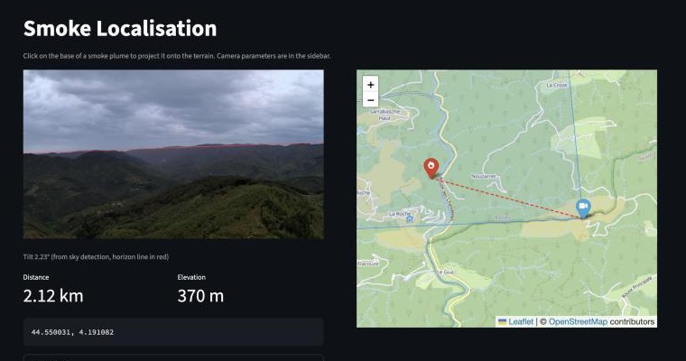

# Smoke Localisation

Estimate the geographic location of smoke detected in a single frame from a [Pyronear](https://pyronear.org/) wildfire detection camera.

Given a camera image and its mounting parameters, the tool projects the clicked pixel onto the terrain and returns GPS coordinates of the smoke origin.



## How it works

### 1. Sky detection & skyline calibration

Wildfire cameras are mounted on towers or hilltops, and their exact orientation is often unknown or approximate. We estimate it from the skyline:

- An **ncnn** model (`skysegsmall_sim-opt-fp16`) produces a binary sky mask
- For each column, the lowest sky pixel gives the **detected skyline**
- From the DSM, we compute the **expected skyline**: for each azimuth, the highest terrain point seen from the camera (with Earth curvature and standard refraction)
- The difference between both is fitted as `tilt + roll * horizontal_angle` with a robust loss, for each azimuth offset within ±5°; the best fit gives **tilt, roll and corrected azimuth**

Ridges are often above the camera, so assuming the skyline is at 0° elevation would bias the tilt by several degrees.

If the clicked pixel falls in the sky region, the app warns the user instead of producing a wrong projection.

### 2. Digital Surface Model (DSM)

The tool downloads [Copernicus DEM GLO-30](https://spacedata.copernicus.eu/collections/copernicus-digital-elevation-model) tiles (30 m resolution) from AWS. This is a **Digital Surface Model** -- it includes tree canopy and building heights, not just bare ground. Tiles are cached locally in `dem_cache/` (not committed to git).

### 3. Ray-terrain intersection

A pinhole camera model converts the clicked pixel `(u, v)` into a 3D ray:

- **Horizontal angle**: `camera_azimuth + (u - 0.5) * HFOV`
- **Vertical angle**: `(0.5 - v) * VFOV - tilt - tan(roll) * (u - 0.5) * HFOV`

The ray is then marched in 5 m steps from the camera position. At each step, the ray altitude is compared against the DSM elevation (queried via bilinear interpolation), lowered by Earth curvature with standard refraction. When the ray drops below the terrain surface, a bisection refinement pinpoints the intersection.

## Streamlit app

```
          +------------------+-------------------+
          |  Camera image    |  OpenStreetMap     |
          |  (click to pick  |  - camera marker   |
          |   a pixel)       |  - hit marker      |
          |                  |  - ray line         |
          |  Sky overlay +   |                    |
          |  horizon line    |                    |
          +------------------+-------------------+
          Sidebar: lat/lon, azimuth, FOV, height
```

### Running

```bash
uv run streamlit run app/app.py
```

### Camera parameters (sidebar)

| Parameter | Description |
|---|---|
| Location (lat, lon) | Camera GPS coordinates (WGS84) |
| Azimuth | Direction the camera centre points (degrees, clockwise from north) |
| Horizontal FOV | Horizontal field of view (degrees) |
| Height above ground | Camera height on tower/mast (metres) |
| Auto-calibrate from the skyline | Fit tilt, roll and azimuth against the DSM skyline (recommended) |
| Manual tilt | Used when auto-calibration is off or fails (degrees, positive = down) |

Aspect ratio is read automatically from the uploaded image.

## Project structure

```
smoke-localisation/
  src/smoke_localisation/
    __init__.py             Public API
    calibration.py          DSM skyline and tilt / roll / azimuth calibration
    camera.py               Camera model, pixel to ray
    dem.py                  DSM download (Copernicus GLO-30), loading, caching
    ray.py                  Ray-terrain intersection (marching + bisection)
    sky.py                  Sky segmentation (ncnn), horizon detection, tilt estimation
    models/skyseg/          ncnn model weights (.param + .bin)
  app/
    app.py                  Streamlit UI
  data/
    cameras.csv             Camera registry (name, lat, lon, fov, height)
    samples/                Demo images (source_site_azimuth_date.jpg)
  tests/                    Unit tests
  dem_cache/                Downloaded DEM tiles (git-ignored)
  pyproject.toml            Dependencies managed by uv
```

## Calibration checks and uncertainty

`calibrate()` searches ±20° around the declared azimuth. It uses sky components
connected to the top edge, so cloud holes can remain inside the sky and detached
bright ground patches do not define the horizon. Uniform masks, poor horizontal
support, median residuals above 0.5°, roll above 5°, and optima at the azimuth
search boundary raise `ValueError`. The app then offers manual tilt.

`tilt_uncertainty_deg` is a **conditional diagnostic radius**, with no assigned
confidence level. It combines disagreement between spatial blocks, tilt spread
among near-optimal azimuth fits, and half a native segmentation pixel. Upsampling
the mask does not reduce this sampling term. `azimuth_uncertainty_deg` exposes
weak azimuth constraints, including flat skylines.

These diagnostics exclude errors in FOV, mounting height, terrain and absolute
orientation. A small residual does not establish absolute accuracy. Optional
`max_skyline_distance_m` and `refraction_coefficient` support sensitivity checks;
the loaded DSM must cover the chosen search distance.

## Dependencies

Managed with [uv](https://docs.astral.sh/uv/). All installed automatically on first run.

- `ncnn` -- sky segmentation inference
- `opencv-python-headless` -- image I/O for the sky detector
- `rasterio` -- reads GeoTIFF DSM tiles
- `pyproj` -- geodesic forward computation (camera to ground point)
- `scipy` -- bilinear interpolation on the DSM grid
- `streamlit`, `folium`, `streamlit-folium`, `streamlit-image-coordinates` -- web UI

## Limitations & investigation topics

### Current limitations

- Linear pixel-to-angle camera model (no lens distortion correction); whether the lenses are closer to pinhole or fisheye is still to be measured
- DSM resolution is 30 m -- individual small structures are not resolved
- Skyline calibration assumes the farthest ridges are visible; haze or low clouds hide them and bias the fit. Skylines beyond the loaded DSM (about 25 km) are ignored
- Refraction uses a fixed standard coefficient (k = 0.13)

### Investigations to improve accuracy

Literature review (FR): [docs/calibration-geolocalisation-etat-de-l-art.pdf](docs/calibration-geolocalisation-etat-de-l-art.pdf)

**Camera model**

- [ ] **Lens distortion correction** -- wide-angle cameras (FOV > 60) have significant barrel distortion. Applying a radial distortion model (Brown-Conrady or fisheye) before projecting would improve accuracy at image edges. Requires calibration coefficients per camera model, or estimation from straight lines in the image.
- [ ] **Per-camera intrinsics from EXIF** -- extract focal length and sensor size from image EXIF metadata to compute FOV automatically instead of requiring manual input.
- [x] **Roll estimation** -- the current model assumes the camera is level (no roll). A tilted horizon in the sky mask could be used to estimate and correct roll angle.

**Tilt calibration**

- [x] **Terrain silhouette vs geometric horizon** -- the sky boundary includes hills and trees, which sit above the true 0-elevation horizon. Investigate using the DSM itself to render the expected terrain silhouette for the given camera position/azimuth, then match it against the detected sky boundary to jointly refine tilt and azimuth.
- [x] **DSM-based horizon rendering** -- for a known camera position, render the expected skyline from the DSM and cross-correlate with the detected sky mask. This would give a precise tilt+azimuth fit without relying on the geometric horizon assumption.
- [ ] **Multi-image tilt averaging** -- use several frames (different times of day, weather) to average out noise in the sky detection and get a more robust tilt estimate.

**Terrain & projection**

- [ ] **Higher resolution DSM** -- investigate using IGN's RGE ALTI (1 m or 5 m resolution, France-specific) or LiDAR-derived DSMs for better precision, especially for nearby hits where 30 m resolution matters.
- [x] **Atmospheric refraction correction** -- for long-range projections (> 10 km), atmospheric refraction bends the ray downward. A standard refraction model (e.g. 4/3 Earth radius approximation) would improve distant hits.
- [ ] **Confidence / uncertainty estimation** -- the ray angle depends on pixel position, tilt, and FOV. Propagating small uncertainties on these inputs would give a confidence ellipse on the ground hit instead of a single point.

**Operational**

- [ ] **Batch mode / API** -- accept detection coordinates from the Pyronear alert pipeline directly (JSON with camera ID, bounding box) instead of manual clicking.
- [ ] **Multi-camera triangulation** -- when two cameras see the same smoke, intersecting their rays would give a much more precise 3D location and remove the dependency on DSM accuracy.
